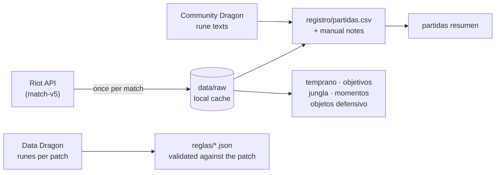

# kindred-lab

[](https://github.com/LeonidasDiaz/kindred-lab/actions/workflows/pruebas.yml)


[Español](README.md) · **English**

I analyze my own League of Legends matches to choose runes, items and a game plan for **Kindred jungle**, instead
of copying builds from sites that average millions of other people's games.

## The problem

Build sites tell you what wins *on average*, not what works for me or why I lose. I wanted to answer with my own
data:

- Which runes should I pick against a given enemy team, and do they actually change the outcome?
- When do my losses start going wrong?
- What part of it is on me as the jungler (where I die, when, and before which objective)?

## How it works



- **Python 3.10+, standard library only.** Nothing to install.
- **The API is called once per match.** Responses are cached on disk and every analysis reads that cache: they
  work offline and without a valid key.
- **Rune values:** Riot stores each rune's numbers as `var1/var2/var3` without saying which is which. The importer
  matches them against Community Dragon's end-of-game rune texts, and they can be calibrated by hand.
- **Editable rules** (`reglas/kindred_runas.json`, `reglas/kindred_objetos.json`): on every patch, `runas
  actualizar` diffs the runes against the previous patch and `reglas validar` flags any rule that points to a rune
  that no longer exists (and suggests the closest one).
- **Items in two layers:** `objetos actualizar` fills prices and stats from Data Dragon on every patch; the
  mechanics (`reglas/objetos_mecanicas.json`) are written and verified by hand and record the patch they were
  verified on. If an item's official description or a number in the game files (Community Dragon) changes, it warns until I review it.
- **A CSV log that imports never overwrite:** they only append new matches and keep the manual notes (what I
  decided in champion select, free-text notes, matches to exclude).
- **A post-game routine** (`rutina.ps1`): imports, asks what I decided in champion select, shows the summary,
  my deaths and my defensive items in that match, and commits the log to git.
- **Each analysis is its own module and command** (`temprano`, `objetivos`, `jungla`, `momentos`,
  `objetos defensivo`), with its own tests.

## Try it without a Riot key

```powershell
git clone https://github.com/LeonidasDiaz/kindred-lab.git
cd kindred-lab
$env:PYTHONPATH="src"          # bash: export PYTHONPATH=src
python -m kindred_lab partidas resumen --registro ejemplos/partidas_ejemplo.csv
```

`ejemplos/partidas_ejemplo.csv` holds 14 **made-up** matches: they show the format, their numbers mean nothing.
To analyze your own matches you need a development key from
[developer.riotgames.com](https://developer.riotgames.com) and a `secretos.json` (template in
`secretos.ejemplo.json`). Every command is documented (in Spanish) in [docs/uso.md](docs/uso.md). The interface is
in Spanish.

## Sample output

**`momentos`** ("moments"): every match split into 5-minute windows, wins vs. losses (real output, 97 matches).
Columns: my deaths, deaths in my own jungle, kills I took part in, team gold gained in the window, gold lead at
the end of the window.

```
tramo       partidas    tus muertes    en tu jungla     participas    oro ganado en el tramo      oro al final
0-5        52 | 45    0.54 | 0.47     0.15 | 0.18    1.15 | 1.02                188 | -279        188 | -279
5-10       52 | 45    0.75 | 0.82     0.13 | 0.24    1.77 | 1.38                599 | -492        786 | -772
10-15      52 | 45    0.65 | 1.13     0.12 | 0.22    2.85 | 1.98               1451 | -1026      2233 | -1797
15-20      49 | 44    0.84 | 1.32      0.1 | 0.39    3.69 | 1.93               2301 | -1654      4153 | -3382
20-25      44 | 43     0.8 | 1.28     0.11 | 0.4      3.3 | 1.86               1367 | -1168      5112 | -3886
25-30      41 | 35     0.8 | 1.66     0.07 | 0.6      3.8 | 2.26               1765 | -2552      5545 | -5727

Tramo en el que cada derrota quedó atrás en oro para ya no recuperarse:
  0-5: 22, 5-10: 4, 10-15: 3, 15-20: 5, 20-25: 3, 25-30: 4, 30-35: 1; nunca atrás hasta el minuto 35: 3
```

The last line: the window in which each loss fell behind in gold for good.

**`jungla --ultima`** ("jungle, last match"): my deaths in the match I just played, one by one: minute, map zone,
who killed me, and whether it was "expensive" (*cara*: within 90 seconds before a dragon or Baron the enemy took).

```
Última partida: LA1_XXXXXXXXXX (2026-10-14, derrota, 4/6/5, 32.8 min)
 minuto  zona            te mató             cara
   2:51  río             Nidalee
   7:18  carril          (sin campeón)
  14:06  tu jungla       Nidalee
  19:40  tu jungla       Talon               sí (dragón enemigo)
  24:12  carril          Jinx
  29:55  río             Talon               sí (Barón enemigo)
```

(Made-up example.)

## What I found

From 93 Solo/Duo matches (February to October 2026). These are trends, not laws; the details and the rules that
came out of them are in [docs/hallazgos.md](docs/hallazgos.md) (Spanish).

- **Baron and the 4th dragon decide my long games.** When my team takes the first Baron I win 82%; when the enemy
  does, 12%. With 4 dragons, 83% vs. 9%. The **first** dragon barely matters: the enemy gets it in 2 of every 3
  matches and I still win half of them.
- **I lose because of when and where I die, not because of vision.** My vision score per minute is almost the
  same in wins and losses (1.47 vs. 1.34). What changes: 4.7 deaths per match in wins vs. 7.7 in losses, and **2.2
  deaths in my own jungle** in losses vs. 0.8 in wins.
- **Two moments:** half of my losses are already behind in gold at minute 5 (lanes, not me), but the big gap opens
  **between minutes 10 and 20**, and that part is on me: I die 4 times more in my own jungle and take part in
  about half as many kills.
- **Runes matter much less than that, and comparing runes is misleading.** Domination looked better than Resolve
  (59% vs. 43% win rate), but most of it came from a good streak in March, and in October I only picked it in easy
  matches. Within the same month the gap almost disappears. Lesson: **split by period and by type of match before
  drawing conclusions**.

That turned into concrete rules: one question in champion select to pick the secondary tree, no solo farming in my
own jungle if we're behind at minute 10, and fighting all-in for the 4th dragon and Baron.

What's next: [roadmap](docs/hoja_de_ruta.md) (in Spanish).

## Tests

```powershell
$env:PYTHONPATH="src"; python -m unittest discover -s tests -v
```

126 offline tests: the matches, timelines and Community Dragon data under `tests/` are synthetic, shaped like the
real responses. GitHub Actions runs them on every push.

## License and notice

Code under the [MIT](LICENSE) license.

kindred-lab isn't endorsed by Riot Games and doesn't reflect the views or opinions of Riot Games or anyone
officially involved in producing or managing Riot Games properties. Riot Games, and all associated properties are
trademarks or registered trademarks of Riot Games, Inc.

## How it was made

I designed and directed the project: which questions to answer, what to measure, how to read the data and which
game rules to draw from it. I wrote the code with help from Claude (Anthropic).
