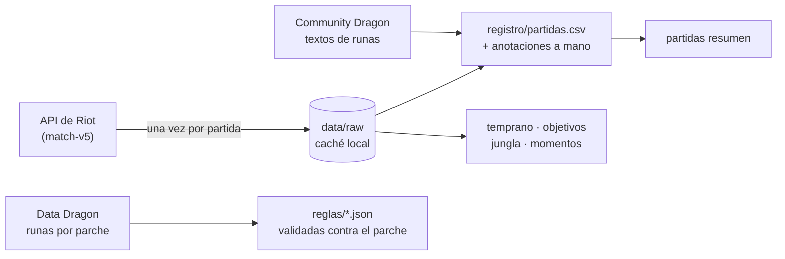

# kindred-lab

[](https://github.com/LeonidasDiaz/kindred-lab/actions/workflows/pruebas.yml)


**Español** · [English](README.en.md)

Analizo mis propias partidas de League of Legends para decidir runas, objetos y plan de juego de **Kindred
jungla**, en lugar de copiar las builds de páginas que promedian millones de partidas ajenas.

## El problema

Las páginas de builds dicen qué gana *en promedio*, pero no qué me funciona a mí ni por qué pierdo. Quería
responder con mis datos:

- ¿Qué runas elijo según el equipo enemigo, y de verdad cambian el resultado?
- ¿En qué momento se tuercen mis derrotas?
- ¿Qué parte depende de mí como jungla (dónde muero, cuándo, antes de qué objetivo)?

## Cómo funciona



- **Python 3.10+ y solo la librería estándar.** Sin dependencias que instalar.
- **La API se consulta una vez por partida.** Las respuestas se guardan en disco y todos los análisis leen esa
  caché: funcionan sin red y sin clave vigente.
- **Valores de runa:** Riot guarda los números de cada runa como `var1/var2/var3` sin decir cuál es cuál. El
  importador los cruza con los textos de fin de partida de Community Dragon y se pueden calibrar a mano.
- **Reglas editables** (`reglas/kindred_runas.json`, `reglas/kindred_objetos.json`): con cada parche, `runas
  actualizar` compara las runas con el parche anterior y `reglas validar` avisa si una regla apunta a una runa que
  ya no existe (y sugiere la parecida).
- **Objetos con dos capas:** `objetos actualizar` llena precios y estadísticas desde Data Dragon en cada parche;
  las mecánicas (`reglas/objetos_mecanicas.json`) las escribí y verifiqué a mano y guardan en qué parche se
  verificaron. Si cambia la descripción oficial de un objeto o un número de los archivos del juego (Community Dragon), avisa hasta que lo revise.
- **Registro en CSV** que la importación nunca sobrescribe: solo agrega partidas nuevas y respeta las anotaciones
  manuales (qué decidí en la selección, notas, partidas a excluir).
- **Una rutina después de cada partida** (`rutina.ps1`): importa, pregunta lo que decidí en la selección, muestra
  el resumen y mis muertes de esa partida, y guarda el registro en git.
- **Cada análisis es un módulo y un comando propio** (`temprano`, `objetivos`, `jungla`, `momentos`), con sus pruebas.

## Pruébalo sin clave de Riot

```powershell
git clone https://github.com/LeonidasDiaz/kindred-lab.git
cd kindred-lab
$env:PYTHONPATH="src"          # bash: export PYTHONPATH=src
python -m kindred_lab partidas resumen --registro ejemplos/partidas_ejemplo.csv
```

`ejemplos/partidas_ejemplo.csv` tiene 14 partidas **inventadas**: sirven para ver el formato, sus números no
significan nada. Para analizar tus partidas necesitas una clave de desarrollo de
[developer.riotgames.com](https://developer.riotgames.com) y un `secretos.json` (plantilla en
`secretos.ejemplo.json`). Todos los comandos están en [docs/uso.md](docs/uso.md). La interfaz está en español.

## Ejemplos de salida

**`momentos`**: cada partida en tramos de 5 minutos, victorias contra derrotas (salida real, 97 partidas).

```
tramo       partidas    tus muertes    en tu jungla     participas    oro ganado en el tramo      oro al final
0-5        52 | 45    0.54 | 0.47     0.15 | 0.18    1.15 | 1.02                188 | -279        188 | -279
5-10       52 | 45    0.75 | 0.82     0.13 | 0.24    1.77 | 1.38                599 | -492        786 | -772
10-15      52 | 45    0.65 | 1.13     0.12 | 0.22    2.85 | 1.98               1451 | -1026      2233 | -1797
15-20      49 | 44    0.84 | 1.32      0.1 | 0.39    3.69 | 1.93               2301 | -1654      4153 | -3382
20-25      44 | 43     0.8 | 1.28     0.11 | 0.4      3.3 | 1.86               1367 | -1168      5112 | -3886
25-30      41 | 35     0.8 | 1.66     0.07 | 0.6      3.8 | 2.26               1765 | -2552      5545 | -5727

Tramo en el que cada derrota quedó atrás en oro para ya no recuperarse:
  0-5: 22, 5-10: 4, 10-15: 3, 15-20: 5, 20-25: 3, 25-30: 4, 30-35: 1; nunca atrás hasta el minuto 35: 3
```

**`jungla --ultima`**: mis muertes de la partida que acabo de jugar, una por una.

```
Última partida: LA1_XXXXXXXXXX (2026-10-14, derrota, 4/6/5, 32.8 min)
 minuto  zona            te mató             cara
   2:51  río             Nidalee
   7:18  carril          (sin campeón)
  14:06  tu jungla       Nidalee
  19:40  tu jungla       Talon               sí (dragón enemigo)
  24:12  carril          Jinx
  29:55  río             Talon               sí (Barón enemigo)
```

(Ejemplo inventado.)

"Cara" = una muerte en los 90 segundos previos a un dragón o Barón que tomó el enemigo.

## Qué descubrí

Con 93 partidas de Solo/Dúo (febrero a octubre de 2026). Son tendencias, no leyes; el detalle y las reglas que
salieron de aquí están en [docs/hallazgos.md](docs/hallazgos.md).

- **El Barón y el 4º dragón deciden mis partidas largas.** Con el primer Barón gano el 82%; si lo toma el enemigo,
  el 12%. Con 4 dragones, 83% contra 9%. El **primer** dragón casi no importa: el enemigo se lo lleva en 2 de cada 3
  partidas y aun así gano la mitad.
- **Pierdo por cuándo y dónde muero, no por la visión.** Mi visión por minuto es casi igual en victorias y derrotas
  (1.47 y 1.34). Lo que cambia: 4.7 muertes por partida en victorias y 7.7 en derrotas, y **2.2 muertes en mi propia
  jungla** en derrotas contra 0.8 en victorias.
- **Dos momentos:** la mitad de mis derrotas ya va atrás en oro al minuto 5 (carriles, no yo), pero la diferencia
  grande se hace **del minuto 10 al 20**, y ahí sí depende de mí: muero 4 veces más en mi jungla y participo en
  casi la mitad de bajas que en mis victorias.
- **Las runas mueven mucho menos que eso, y comparar runas engaña.** Dominación parecía ganar más que Valor (59%
  contra 43%), pero casi todo venía de una buena racha en marzo, y en octubre solo la elegía en partidas fáciles.
  Comparando el mismo mes, la diferencia casi desaparece. Lección: **separar por periodo y por tipo de partida
  antes de concluir**.

De ahí salieron reglas concretas: una pregunta en la selección de campeones para elegir la secundaria, no farmear
solo en mi jungla si al minuto 10 vamos atrás, y pelear el 4º dragón y el Barón con todo.

Qué sigue: [hoja de ruta](docs/hoja_de_ruta.md).

## Pruebas

```powershell
$env:PYTHONPATH="src"; python -m unittest discover -s tests -v
```

84 pruebas sin red: las partidas, timelines y datos de Community Dragon de `tests/` son sintéticos, con la forma
de las respuestas reales. GitHub Actions las corre en cada push.

## Licencia y aviso

Código bajo licencia [MIT](LICENSE).

kindred-lab isn't endorsed by Riot Games and doesn't reflect the views or opinions of Riot Games or anyone
officially involved in producing or managing Riot Games properties. Riot Games, and all associated properties are
trademarks or registered trademarks of Riot Games, Inc.

## Cómo se hizo

El proyecto lo diseñé y dirigí yo: qué preguntas responder, qué medir, cómo leer los datos y qué reglas de juego
sacar de ellos. El código lo escribí con ayuda de Claude (Anthropic).
